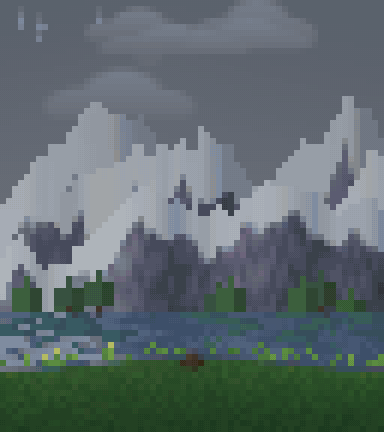
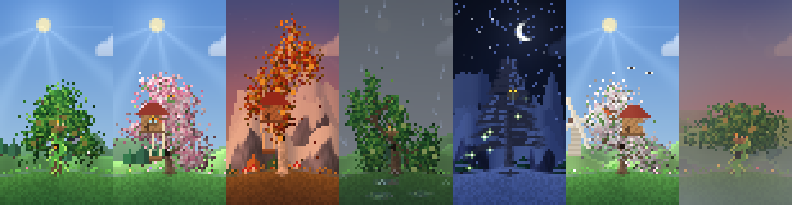

<div align="center">

# 🌳 tree

**Procedural trees that grow out of the ground, right in your terminal.**
Every tree is simulated, never drawn from a template. Wind, rain, seasons, day and night. Cut it, burn it, watch it grow back.

[](#install)
[](#install)
[](LICENSE)
[](#how-it-works)



</div>

---

## What it is

A single Python file that turns a terminal pane into a small living world. A tree grows from a seed: branches fork, reach for light, avoid their neighbours, thicken with age, and sprout leaves from the twigs rather than as a cloud. No two are alike. The same seed always gives the same tree.

- **Endless mode.** `i`, or `--random`. A new tree with a random species, season, weather and wind grows, stands for a moment, and the next one starts by itself. Leave it running next to your work.
- **Seven species.** `oak`, `sakura`, `birch`, `acacia`, `willow`, `apple`, `pine`. Apple trees blossom in spring and carry ripening fruit.
- **Four seasons.** Spring blossom, summer green, autumn leaf fall, winter snow, with drifts on the ground and ripples in puddles.
- **Weather and light.** Clear, rain, fog, thunderstorm. Day, dusk, night, or the day cycling on its own. Sun rays, clouds, rainbows after rain, a moon, shooting stars.
- **Wildlife.** Birds, butterflies, fireflies, an owl at night, a squirrel by day, now and then a deer. Mushrooms, flowers and grass between the roots.
- **Hands-on.** Hold the left mouse button and drag to cut: branches fall with everything growing on them, and the stump regrows. Pick up a lighter and set the tree on fire: flames climb the trunk, the wind helps, rain puts it out, and a burnt-through trunk falls as a log.
- **Decorations.** A hollow with an owl, ivy, a swing, a treehouse. They appear as the tree ages and vanish with the branch they hang from.

<div align="center">

</div>

## Install

```bash
pip install numpy
git clone https://github.com/34823/tree.git
cd tree
python3 tree.py
```

You need a terminal with 24-bit colour (WezTerm, kitty, iTerm2, Alacritty, Windows Terminal, and most modern ones). Make the pane tall: the taller it is, the finer the picture.

## Run

```bash
python3 tree.py                          # the tree you left last time
python3 tree.py --random                 # endless mode
python3 tree.py --preset sakura --season spring --seed 7
python3 tree.py --new --weather rain --tod night --wind 3
```

| Flag | Meaning |
|---|---|
| `--preset` | `oak` `sakura` `birch` `acacia` `willow` `apple` `pine` |
| `--season` | `spring` `summer` `autumn` `winter`, default follows the date |
| `--seed N` | the same seed gives the same tree |
| `--wind 0..4` | wind strength |
| `--weather` | `clear` `rain` `fog` `storm` |
| `--tod` | `day` `dusk` `night`, default `auto` |
| `--random` | endless mode |
| `--new` | start from a seed, ignore the saved tree |
| `--sharp 0..6` | local contrast: 0 is soft, 6 is crisp |

## Controls

| Key | Action |
|---|---|
| mouse drag | cut branches and leaves |
| `f` | lighter: hold the button near a branch, leaf or grass to set it alight |
| `n` | new tree |
| `i` | endless mode on/off |
| `p` / `s` | species / season |
| `↑` `↓` | wind |
| `←` `→` | growth speed, from paused to ×16 |
| `w` / `d` | weather / time of day |
| `e` | decorations: auto, all, none |
| `b` | background: hills, mountains, lake, village, windmill |
| `[` `]` | sharpness |
| `q` | quit |

The bar at the bottom holds clickable buttons for the same actions.

## Make a still or a video

```bash
python3 tree.py --shot tree.png --size 44x40 --scale 5 --preset birch --season autumn --tod dusk
python3 tree.py --video tree.mp4 --seconds 24 --size 64x36      # needs ffmpeg
```

`--burn 9` sets the trunk on fire and waits nine seconds before the shot.

## How it works

- **Picture.** Each terminal cell holds two vertical pixels using half-block characters in 24-bit colour, composited in a numpy array and flushed once per frame.
- **Tree.** A simulation of growing tips with a limited life. Tips branch, lean towards light, steer around neighbours, and the trunk thickens as the tree ages. The seed fixes the shape, so a resize regrows the same tree.
- **Time.** The age of the tree is saved in `~/.cache/tree/state.json`, so it keeps growing between runs. Cut branches regrow from the stump, and their leaves come back lighter.

## License

MIT
